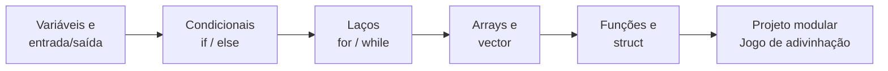

# 🧠 Data Structures and Algorithms


Atividades da disciplina de **Data Structures and Algorithms**, desenvolvidas em **C++**. O repositório vai dos primeiros exercícios de sala (variáveis, entrada e saída) até os Checkpoints, que avaliam condicionais, laços, funções e a evolução de um jogo completo.

> **Aluna:** Isadora Soares Couto · **RM:** 576852
> **Curso:** _preencher_ · **Semestre:** _preencher_

---

## 📑 Sumário

- [Estrutura](#-estrutura)
- [Exercícios em aula](#-exercícios-em-aula)
- [Praticando C++](#-praticando-c)
- [Checkpoint 1](#-checkpoint-1--estruturas-condicionais)
- [Checkpoint 2](#-checkpoint-2--jogo-de-adivinhação)
- [Como executar](#️-como-executar)

---

## 📂 Estrutura

```
Data Structures and Algorithms/
├── Exercícios em aula/     → fundamentos vistos em sala
├── Praticando c++/         → exercícios extras de fixação
├── Checkpoint 1/           → condicionais (if / else if / else)
├── Checkpoint 2/           → jogo de adivinhação em 5 versões + PDF
└── README.md
```

| Pasta | Tipo | Arquivos | Foco |
|---|---|:---:|---|
| [Exercícios em aula](./Exercícios%20em%20aula) | Atividades de sala | 11 | Tipos de dados, `if/else`, `bool`, arrays, `vector`, funções |
| [Praticando c++](./Praticando%20c++) | Prática extra | 9 | `cin/cout`, `getline`, `while`, `for`, `struct`, referências |
| [Checkpoint 1](./Checkpoint%201) | 📝 Checkpoint | 5 | Estruturas condicionais aplicadas a problemas do dia a dia |
| [Checkpoint 2](./Checkpoint%202) | 📝 Checkpoint | 5 versões + PDF | Laços, validação, modularização e documentação |



---

## 🏫 Exercícios em aula

Atividades feitas durante as aulas, na ordem do conteúdo: tipos de dados e entrada/saída, condicionais, funções e arrays.

| Arquivo | Descrição | Conceitos |
|---|---|---|
| `cadastro_aluno.cpp` | Cadastro de aluno (nome, idade, altura) | `string`, `int`, `double` |
| `idade_futura.cpp` | Calcula a idade daqui a N anos | `int`, operações |
| `cadastro_produto.cpp` | Produto com preço e estoque | `string`, `double`, `int` |
| `cadastro_veiculo.cpp` | Marca, ano e categoria de habilitação | `string`, `int`, `char` |
| `verificacao_matricula.cpp` | Dados acadêmicos e status da matrícula | `bool` |
| `acesso_baladinha_if_else.cpp` | Libera a entrada apenas para maiores de 18 | `if/else` |
| `acesso_baladinha_bool.cpp` | Mesmo problema, guardando a decisão em um `bool` | `bool` |
| `media_notas_funcao.cpp` | Média de duas notas para 5 alunos, com `calcularMedia()` | funções, `for` |
| `media_notas_array.cpp` | Média de 5 notas em um array | arrays, `for` |
| `maior_elemento_array.cpp` | Maior valor de um array de 10 inteiros | arrays, comparação |
| `vetor_alunos.cpp` | Cria e percorre um `vector<string>` | `vector`, `push_back` |

---

## 💪 Praticando C++

Exercícios extras de fixação. Os comentários nos arquivos seguem a numeração de uma lista de estudos, que organiza as seções abaixo.

| Tema | Arquivo | Descrição |
|---|---|---|
| 🔤 Variáveis, `cin` e `cout` | `cadastro_filme.cpp` | Nome, ano e nota de um filme, usando `getline` para nomes compostos |
| | `cadastro_jogador.cpp` | Nome, idade e rank (`char`) de um jogador |
| | `ficha_jogador.cpp` | Ficha com nome, idade, altura, pontuação e status ativo/inativo |
| ➕ Operações | `soma_dois_numeros.cpp` | Soma dois inteiros |
| 🔀 Condicionais | `positivo_ou_negativo.cpp` | Informa se o número é positivo ou negativo |
| | `verificacao_idade_dirigir.cpp` | Informa se pode dirigir (18 anos ou mais) |
| 🔁 Laços | `tabuada.cpp` | Tabuada de 1 a 10 com `for` |
| | `jogo_adivinhacao.cpp` | Adivinhar o número 12, com dicas de "maior" ou "menor" |
| 🧱 Estruturas | `comparar_datas.cpp` | Lê duas datas com `struct Data`, formata como `dd/mm/aaaa` e indica a mais antiga |

**Destaques técnicos:** `getline` para ler nomes com espaço · `struct Data` para agrupar dia, mês e ano · passagem por referência (`Data &data`) em `lerData` · `setw` e `setfill` (`<iomanip>`) para zeros à esquerda · comparação de datas em cascata (ano, mês, dia).

> 🔗 O `jogo_adivinhacao.cpp` é o ponto de partida do projeto do Checkpoint 2.

---

## 📝 Checkpoint 1 — Estruturas condicionais

Avaliação focada em **tomada de decisão**: cada programa recebe dados, aplica regras com `if / else if / else` e exibe o resultado.

| Arquivo | Cenário | Regra |
|---|---|---|
| `verificacao_aprovacao.cpp` | 🎓 Aprovação de aluno | Aprovado com nota ≥ 6 |
| `classificacao_etaria.cpp` | 👶 Classificação etária | Até 12 criança · 13 a 17 adolescente · 18+ adulto |
| `verificacao_elegibilidade.cpp` | 🗳️ Voto | < 16 não permitido · 16 e 17 facultativo · 18 a 69 obrigatório · 70+ facultativo |
| `desconto.cpp` | 🛒 Desconto | Compras acima de R$ 200 recebem 10% de desconto |
| `bonus_salarial.cpp` | 💼 Bônus por desempenho | Nota 9 a 10 → 15% · 7 a 8,99 → 10% · 5 a 6,99 → 5% · abaixo de 5 → sem bônus |

**Conceitos:** `cin` e `getline` · tipos `int`, `float`, `double` e `string` · operadores relacionais e lógicos (`&&`) · cadeias `if / else if / else` · cálculo de percentuais.

---

## 🎯 Checkpoint 2 — Jogo de adivinhação

Jogo em C++ construído de forma incremental em **cinco versões**, da lógica básica até um programa modular com sistema de dicas. A documentação completa (esboço de interface, requisitos, modelo e fluxograma) está no PDF `CP 02 → Desenvolvimento do jogo de adivinhação (2).pdf`, na pasta do checkpoint.

### 🕹️ Como o jogo funciona

1. O computador sorteia uma **bola** de 1 a 20, que vira o **alvo**.
2. O jogador digita um **palpite entre 1 e 100**.
3. Se acertar o alvo, **vence**.
4. Se errar, o computador sorteia outra bola e **soma ao alvo**, que cresce a cada rodada.
5. Se o alvo passar de **100**, o **computador vence**.

```
Digite seu palpite (1 a 100): 15
O alvo era: 12
Seu palpite foi: 15
Voce errou! Tente novamente.
Dica: O proximo alvo estará entre 13 e 32.
```

### 🧬 Evolução

| Versão | Arquivo | O que mudou |
|:---:|---|---|
| **1** | `versao1_estrutura_inicial.cpp.cpp` | Lógica básica com `rand()`, `while` e `if/else` |
| **2** | `versao2_aleatoriedade.cpp.cpp` | `srand(time(0))` para variar os sorteios e mensagem de erro após palpite incorreto |
| **3** | `versao3_validacao.cpp.cpp` | Validação do palpite (1 a 100) com `while` |
| **4** | `versao4_otimizacao.cpp.cpp` | Leitura, validação e atualização do alvo em um único laço, sem repetição |
| **5** | `versao5_final_modular.cpp.cpp` | Modularização em funções e sistema de dicas |

### 🧩 Arquitetura da versão final

| Função | Responsabilidade | Requisitos |
|---|---|---|
| `sortearBola()` | Gera um número de 1 a 20 | RF01, RF02, RF07 |
| `receberPalpite()` | Lê e valida o palpite | RF03, RF04 |
| `exibirDica()` | Mostra o intervalo possível do próximo alvo, respeitando o limite de 100 | RF08 |
| `main()` | Inicializa, atualiza o alvo, compara, repete e encerra | RF02, RF05, RF07, RF08, RF09 |

<details>
<summary>📌 Requisitos funcionais (RF01 a RF11)</summary>

| ID | Requisito |
|:---:|---|
| RF01 | Sortear uma bola aleatória entre 1 e 20 |
| RF02 | Inicializar o alvo com a primeira bola |
| RF03 | Solicitar um palpite entre 1 e 100 |
| RF04 | Validar o intervalo e pedir novamente se inválido |
| RF05 | Comparar o palpite com o alvo |
| RF06 | Exibir o alvo, o palpite e o resultado da rodada |
| RF07 | Após um erro, sortear outra bola e somá-la ao alvo |
| RF08 | Exibir o intervalo possível do próximo alvo (incrementos de 1 a 20, limite de 100) |
| RF09 | Repetir as rodadas enquanto não houver acerto e o alvo estiver dentro do limite |
| RF10 | Encerrar quando o jogador acertar ou o alvo ultrapassar 100 |
| RF11 | Exibir a mensagem final correspondente |

</details>

**Conceitos:** `rand()` e `srand(time(0))` · laços `while` aninhados · validação de entrada · refatoração · funções com retorno e `void` · decomposição de problemas.

---

## ▶️ Como executar

**Pré-requisito:** um compilador C++ (g++, MinGW ou MSVC).

```bash
# g++ (Linux / macOS / MinGW)
g++ arquivo.cpp -o programa
./programa

# MSVC (Developer Command Prompt)
cl /EHsc arquivo.cpp
arquivo.exe
```

> 💡 Os arquivos do `Checkpoint 2` terminam em `.cpp.cpp`. Se der erro, renomeie para `.cpp`.

---

<p align="center">Feito com 💜 durante a graduação na FIAP</p>
