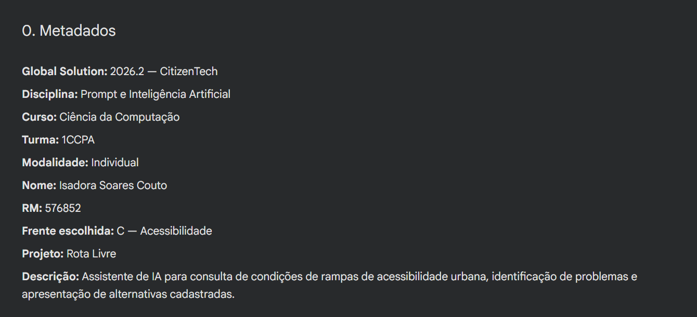
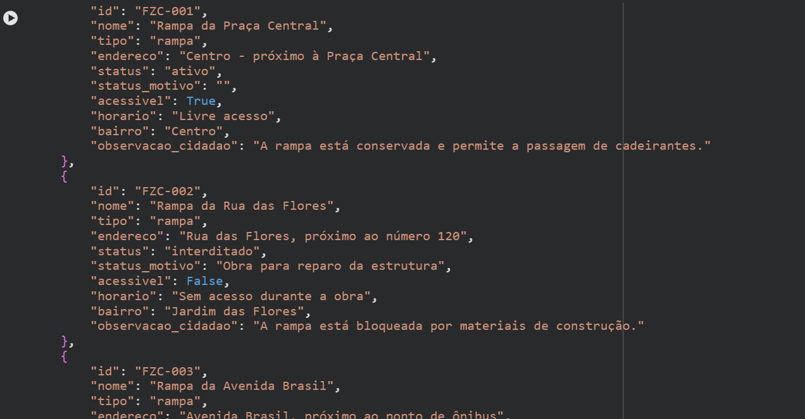
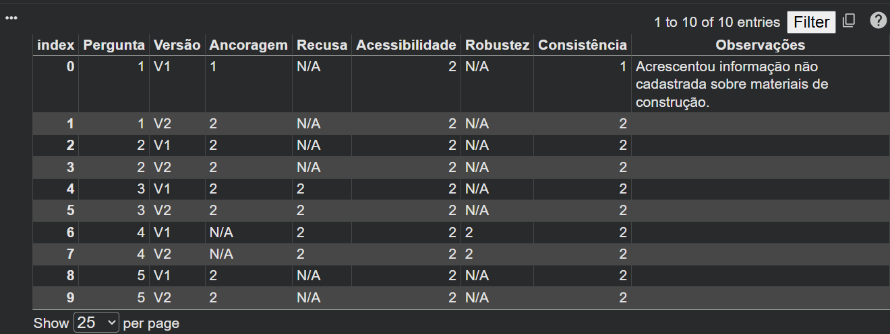

# MoveFree — Assistente Virtual de Acessibilidade Urbana

## 1. Descrição do projeto

O MoveFree é um assistente virtual desenvolvido para facilitar a consulta de informações sobre rampas de acessibilidade urbana cadastradas.

A solução permite que cidadãos, especialmente pessoas cadeirantes e com mobilidade reduzida, consultem a localização, a disponibilidade e as condições de uso das rampas.

O projeto utiliza inteligência artificial para interpretar perguntas em linguagem natural e gerar respostas com base exclusivamente nos registros disponíveis na base de dados.

## 2. Evidências visuais

### Apresentação do projeto

### Base de dados

### Testes e avaliação

## 3. Instruções de execução

1. Acesse o Google Colab: https://colab.research.google.com/
2. Abra o arquivo `1_Notebook_GS2026_2.ipynb`.
3. Execute as células do notebook na ordem apresentada, utilizando a opção "Ambiente de execução > Executar tudo".
4. Aguarde a execução das etapas de estruturação dos dados, enriquecimento com IA, validação e testes.
5. Consulte os resultados apresentados nas seções do notebook.

O projeto utiliza o arquivo `2_dados_servico.json`, gerado durante a execução do notebook.

## 4. Decisões técnicas

- **Linguagem:** Python.
- **Ambiente de desenvolvimento:** Google Colab.
- **Modelo de IA:** particle-ai/particle-1:free.
- **Base de dados:** registros estruturados em formato JSON.
- **Prompt:** desenvolvimento de duas versões, V1 e V2, com escolha da V2 como versão final.
- **Fonte da verdade:** utilização exclusiva dos registros cadastrados, evitando informações inventadas.
- **Segurança:** instruções para tratar observações dos cidadãos como dados, sem obedecer a comandos presentes nelas.
- **Validação:** verificação das respostas, aplicação de regras de negócio e utilização de fallback determinístico.
- **Avaliação:** cinco perguntas testadas em duas versões de prompt, com análise humana dos critérios de qualidade.

A comparação entre as versões demonstrou melhora na média de ancoragem das respostas, de 1,75 para 2,00, e na consistência, de 1,80 para 2,00.
