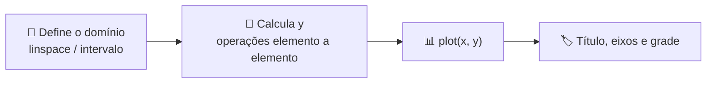

<div align="center">

# 📐 Checkpoints — Modelagem Matemática Computacional

**Funções, gráficos e limites na prática, com scripts em MATLAB/Octave e resolução de limites em PDF**


**Autora:** Isadora Soares Couto · **RM:** 576852

</div>

---

## 📑 Sumário

- [🎯 Sobre](#-sobre)
- [🗂️ Estrutura da pasta](#️-estrutura-da-pasta)
- [📈 Checkpoint 01 — Funções e gráficos](#-checkpoint-01--funções-e-gráficos)
  - [Aula 02 — Parábola](#aula-02--parábola)
  - [Aula 03 — Função de 1º grau](#aula-03--função-de-1º-grau-valorização-de-imóvel)
  - [Aula 03 — Função de 2º grau](#aula-03--função-de-2º-grau-altura-de-um-objeto)
  - [Aula 03 — Função de 3º grau](#aula-03--função-de-3º-grau)
- [♾️ Checkpoint 02 — Limites e continuidade](#️-checkpoint-02--limites-e-continuidade)
  - [Parte A](#parte-a--descontinuidade-removível)
  - [Parte B](#parte-b--descontinuidade-infinita)
  - [Parte C](#parte-c--descontinuidade-por-salto)
- [▶️ Como executar](#️-como-executar)
- [🛠️ Tecnologias](#️-tecnologias)

---

## 🎯 Sobre

Esta pasta reúne os **dois checkpoints** da disciplina de *Modelagem Matemática Computacional*:

| Checkpoint | Tema | Formato |
|:---:|---|---|
| **01** | Construção e visualização de funções (1º, 2º e 3º grau) | 4 scripts `.m` |
| **02** | Limites, continuidade e tipos de descontinuidade | 1 PDF resolvido |

A ideia central: **transformar uma expressão matemática em um modelo que dá para ver, testar e interpretar**, seja o valor de um imóvel ao longo dos anos, a altura de um objeto lançado ou o custo de um servidor.

---

## 🗂️ Estrutura da pasta

```text
📦 Checkpoint
├── 📁 Checkpoint-01
│   ├── 📁 Aula-02
│   │   └── 📄 grafico_parabola.m
│   └── 📁 Aula-03
│       ├── 📄 funcao_1grau_imovel.m
│       ├── 📄 funcao_2grau_altura.m
│       └── 📄 funcao_3grau.m
├── 📕 Checkpoint-02.pdf
├── 🖼️ assets/            (imagens usadas neste README)
└── 📘 README.md
```

| Arquivo | Conteúdo | Tipo de função |
|---|---|---|
| [`grafico_parabola.m`](Checkpoint-01/Aula-02/grafico_parabola.m) | Parábola `y = x² − 4x + 2` | 2º grau |
| [`funcao_1grau_imovel.m`](Checkpoint-01/Aula-03/funcao_1grau_imovel.m) | Valorização de um imóvel | 1º grau |
| [`funcao_2grau_altura.m`](Checkpoint-01/Aula-03/funcao_2grau_altura.m) | Altura de um objeto no tempo | 2º grau |
| [`funcao_3grau.m`](Checkpoint-01/Aula-03/funcao_3grau.m) | Polinômio cúbico | 3º grau |
| [`Checkpoint-02.pdf`](Checkpoint-02.pdf) | Limites e continuidade (3 partes) | Racional e por partes |

---

## 📈 Checkpoint 01 — Funções e gráficos

Em todos os scripts o fluxo é o mesmo:



### Aula 02 — Parábola

📄 [`Aula-02/grafico_parabola.m`](Checkpoint-01/Aula-02/grafico_parabola.m)

$$y = x^2 - 4x + 2$$

- Domínio: 100 pontos entre **−2 e 6** (`linspace`)
- Concavidade para cima (`a = 1 > 0`), com **vértice em (2, −2)**

<div align="center">

</div>

```matlab
x = linspace(-2, 6, 100);
y = x.^2 - 4*x + 2;
plot(x, y);
```

### Aula 03 — Função de 1º grau (valorização de imóvel)

📄 [`Aula-03/funcao_1grau_imovel.m`](Checkpoint-01/Aula-03/funcao_1grau_imovel.m)

Um imóvel de **R$ 700.000,00** que valoriza **R$ 50.000,00 por ano**. Com o valor em dezenas de milhares de reais:

$$y = 70 + 5x$$

- `x` = tempo em anos (0 a 10)
- Em 10 anos, o imóvel chega a **R$ 1.200.000,00** (`y = 120`)

<div align="center">

</div>

### Aula 03 — Função de 2º grau (altura de um objeto)

📄 [`Aula-03/funcao_2grau_altura.m`](Checkpoint-01/Aula-03/funcao_2grau_altura.m)

$$h(t) = -5t^2 + 20t + 2$$

- `t` em segundos, de 0 a 5 (51 pontos)
- Parte de **2 m**, atinge o **máximo de 22 m em t = 2 s** e volta ao solo (h = 0) pouco depois de **t ≈ 4,1 s**

<div align="center">

</div>

> 💡 O script plota até `t = 5`, então a curva passa para valores negativos, que fisicamente significariam "abaixo do solo". Para o modelo físico, vale restringir o domínio a `t ≤ 4,1`.

### Aula 03 — Função de 3º grau

📄 [`Aula-03/funcao_3grau.m`](Checkpoint-01/Aula-03/funcao_3grau.m)

$$f(x) = -x^3 + 15x^2 + 5$$

- Domínio: `x` de 0 a 10, passo 0,1
- Crescente nesse intervalo, com o **ponto de máximo local em x = 10** (`f(10) = 505`)

<div align="center">

</div>

---

## ♾️ Checkpoint 02 — Limites e continuidade

📕 [`Checkpoint-02.pdf`](Checkpoint-02.pdf) · 3 páginas · resolução manuscrita + explicação

<div align="center">


</div>

### Parte A — Descontinuidade removível

$$f(x) = \frac{x^2 - 9}{x - 3}$$

1. Fatorando: $\dfrac{(x-3)(x+3)}{x-3} = x + 3$
2. $\displaystyle\lim_{x \to 3} f(x) = 3 + 3 = \mathbf{6}$
3. Mas $f(3) = \dfrac{0}{0}$: **a função não está definida em x = 3**

**Conclusão:** descontinuidade **removível** (um "buraco" em `(3, 6)`).

<div align="center">

</div>

### Parte B — Descontinuidade infinita

$$g(x) = \frac{1}{50 - x}$$

Contexto: **custo de um servidor** em função do número de usuários `x`, com limite de 50.

Teste numérico aproximando `x` de 50 pela esquerda:

| x | 49 | 49,9 | 49,99 |
|:---:|:---:|:---:|:---:|
| g(x) | 1 | 10 | 100 |

$$\lim_{x \to 50^-} \frac{1}{50 - x} = +\infty$$

**Conclusão:** descontinuidade **infinita** (assíntota vertical em `x = 50`).

> 🖥️ **Na prática:** o servidor tem limites físicos e financeiros. Antes de o custo "chegar ao infinito", ele pode ficar lento, recusar conexões ou parar. O `+∞` indica que, no modelo, o custo cresce sem limite perto de 50 usuários, não que o custo real seja infinito.

<div align="center">

</div>

### Parte C — Descontinuidade por salto

$$h(x) = \begin{cases} 100, & x < 10 \\ 150, & x \ge 10 \end{cases}$$

Contexto: uma **comissão** que passa de **R$ 100** para **R$ 150** quando `x` chega a 10. Pela esquerda o valor se aproxima de 100; pela direita, de 150. Como os limites laterais em `x = 10` são diferentes, o limite **não existe**.

| Condição de continuidade | Resultado |
|---|:---:|
| 1. `h(10)` está definida (`h(10) = 150`) | ✅ |
| 2. O limite existe (`lim⁻ = 100` e `lim⁺ = 150`) | ❌ |
| 3. O limite é igual a `h(10)` | ❌ |

**Conclusão:** descontinuidade **por salto**.

<div align="center">

</div>

### 🧾 Resumo dos tipos de descontinuidade

| Parte | Função | Tipo | Limite em x₀ |
|:---:|---|---|---|
| **A** | $\frac{x^2-9}{x-3}$ | Removível | 6 |
| **B** | $\frac{1}{50-x}$ | Infinita | +∞ |
| **C** | por partes | Salto | não existe |

---

## ▶️ Como executar

Os scripts rodam no **MATLAB** ou no **GNU Octave** (gratuito).

1. Abra o MATLAB/Octave (ou o [MATLAB Online](https://matlab.mathworks.com/)).
2. Navegue até a pasta do projeto.
3. Execute o script desejado:

```matlab
cd Checkpoint-01/Aula-03
funcao_2grau_altura
```

Cada script abre uma janela com o gráfico correspondente.

---

## 🛠️ Tecnologias


---

<div align="center">

Feito por **Isadora Soares Couto** · FIAP · 2026

</div>