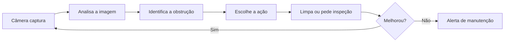

# 📷 Câmeras autolimpantes de classificação veicular

Câmeras autolimpantes com identificação inteligente de obstruções e classificação de veículos e eixos para pedágios.

## Problema

- Câmeras de monitoramento rodoviário podem ter a visão prejudicada por teias, insetos, fezes de pássaros, poeira e outros resíduos. Isso reduz a qualidade das imagens e exige limpeza manual, principalmente em locais altos, de difícil acesso ou com tráfego intenso.
- O sensor atual para classificação de veículos em pedágios exige muito monitoramento.

## Proposta

Um módulo físico acoplado à câmera que **monitora a qualidade da imagem**, **identifica obstruções por visão computacional** e **aciona um mecanismo de limpeza** quando for seguro. Um segundo sistema integrado aprende a **classificar os veículos**.

## Solução

As duas funcionalidades compartilham a captura e o processamento de imagens, mas têm objetivos distintos.

### 1. Identificação de obstruções

O modelo reconhece categorias como teia de aranha, inseto, fezes de pássaros, poeira e manchas, obstrução não identificada e possível ninho ou animal. Cada resultado tem um **nível de confiança**; se for baixo, o sistema pede verificação antes de agir.

No protótipo, dá para começar com imagens de exemplo e um modelo simples, sem treinar uma IA do zero.

### 2. Classificação de veículos e eixos

Usa as imagens da câmera para identificar o tipo de veículo e estimar a quantidade de eixos, definindo a categoria tarifária do pedágio.

1. **Captura:** a câmera registra o veículo passando pela faixa.
2. **Detecção:** o modelo localiza o veículo na imagem.
3. **Categoria:** estima se é moto, automóvel, ônibus, caminhão ou outra categoria da cobrança.
4. **Rodas e eixos:** estima quantidade e disposição, analisando vários quadros para reduzir erros de oclusão e movimento.
5. **Rodagem:** verifica se é simples ou dupla, quando relevante.
6. **Eixos suspensos:** analisa a sequência de imagens; uma imagem isolada nem sempre confirma o contato com o solo, então podem ser usados sensores complementares.
7. **Classe tarifária:** combina os dados com as regras da concessionária.
8. **Validação:** atribui confiança; em caso de divergência, o caso vai para validação antes da cobrança.
9. **Envio:** a classificação segue para o sistema de controle do pedágio.

### 3. Integração

A câmera autolimpante preserva a qualidade da imagem; o módulo de classificação usa essa imagem. Ao detectar uma obstrução, o sistema registra um alerta e, se houver mecanismo, aciona a limpeza e confere a nova imagem. Se continuar ruim, sinaliza inspeção.

> A classificação não deve depender só de imagens ruins. Nesses casos, sensores complementares ou validação evitam cobranças incorretas.

## Mecanismo de limpeza

| Mecanismo | Aplicação | Limitações |
|---|---|---|
| Mini limpador com motor ou servo | Resíduos superficiais em um visor protetor compatível | Pode riscar, desgastar a borracha ou espalhar sujeira; falha mecânica pode obstruir a visão |
| Jato de ar | Poeira leve ou insetos soltos | Não remove resíduos aderidos; exige fonte de ar e controle de pressão |
| Bico de líquido com limpador | Manchas aderidas | Exige reservatório, reposição, vedação e líquido compatível |
| Revestimento repelente | Reduz aderência de água e certos resíduos | Não substitui a limpeza; precisa ser validado para o ambiente |

**Após a limpeza**, o sistema compara a imagem anterior com a posterior. Se a obstrução persistir, tenta uma segunda ação dentro de limites seguros ou emite alerta de manutenção.

**Proteção de animais:** ninho ou animal não é sujeira. O sistema suspende a limpeza mecânica na região e pede inspeção humana, pois a IA pode errar.

## Componentes

| Componente | Função |
|---|---|
| Câmera existente | Capturar as imagens |
| Processamento em Python | Analisar imagens, executar regras e registrar resultados |
| Modelo de visão computacional | Estimar se há obstrução e o tipo provável |
| ESP32 ou Arduino compatível | Controlar o servo ou outro mecanismo |
| Mecanismo de limpeza | Agir sobre um visor protetor adequado |
| Sensor de posição ou limite (se necessário) | Evitar que o mecanismo passe do movimento permitido |
| Painel de monitoramento | Mostrar estado da câmera, obstruções, ações e alertas |

## Prós, contras e viabilidade

| Critério | Prós | Contras | Como reduzir o risco |
|---|---|---|---|
| Inovação | Une identificação do tipo de obstrução e limpeza automática | Câmeras com limpadores já existem; o diferencial está na IA | Comparar com soluções existentes |
| Manutenção | Menos visitas presenciais | O mecanismo também exige manutenção, energia e reposição | Registrar limpezas feitas e as que ainda exigem humano |
| Detecção por IA | Resposta mais cedo | Reflexos, chuva e iluminação geram falsos positivos/negativos | Testar várias condições e criar a categoria "incerto" |
| Identificação do tipo | Ações distintas para cada sujeira | Categorias parecidas se confundem | Começar com poucas classes |
| Mecanismo físico | Demonstrável em pequena escala | Atrito, desgaste e força excessiva podem danificar o visor | Visor substituível, curso do servo limitado, baixa força |
| Ambiente externo | Útil em locais expostos e de difícil acesso | Chuva, calor, poeira, vibração e umidade exigem proteção | — |
| Proteção de animais | Reconhece casos que pedem cuidado | A IA pode confundir ninho com sujeira ou não ver o animal | Suspender em casos incertos e exigir confirmação humana |
| Energia e conectividade | Integra ao sistema existente | Câmeras antigas podem não dar acesso a imagens ou controle | Prototipar local e avaliar modelos de câmera depois |
| Custo | Prova de conceito barata | Solução externa robusta custa bem mais que a maquete | Separar custo do protótipo e da instalação real |
| Economia | Menos deslocamentos | Não é garantida; depende da frequência de obstrução e da confiabilidade | Comparar em cenário de teste, sem extrapolar para a rodovia |

## Custo estimado do protótipo

| Componente | Faixa |
|---|--:|
| ESP32 ou placa compatível | R$ 35–90 |
| Servo motor e peças de ligação | R$ 20–60 |
| Visor transparente substituível e suporte | R$ 20–60 |
| Fios, protoboard e alimentação | R$ 25–70 |
| Estrutura e materiais da maquete | R$ 30–100 |
| Câmera simples (pode ser webcam ou celular) | R$ 40–120 |
| **Total** (sem frete nem computador novo) | **R$ 170–500** |

## Diferenciais do projeto

- **Limpeza acionada por classificação:** aciona o mecanismo compatível com o tipo de sujeira.
- **Verificação antes/depois:** o painel mostra as imagens e estima se melhorou.
- **Limpeza só quando necessária:** reduz desgaste e consumo.
- **Alertas de baixa confiança:** se não souber classificar, pede inspeção.
- **Modo de proteção de animais:** bloqueia a limpeza e gera alerta.
- **Histórico de manutenção:** guarda ocorrências, ações e falhas.

## Tecnologias

- **Python** com **OpenCV** e **MediaPipe**, conectado ao Arduino
- **AWS**
- **Google Sheets API** no início; depois, banco de dados próprio

## Objetivo final

Uma **maquete de rodovia** usando o sistema, com uma mini câmera e um carrinho de brinquedo com controle.